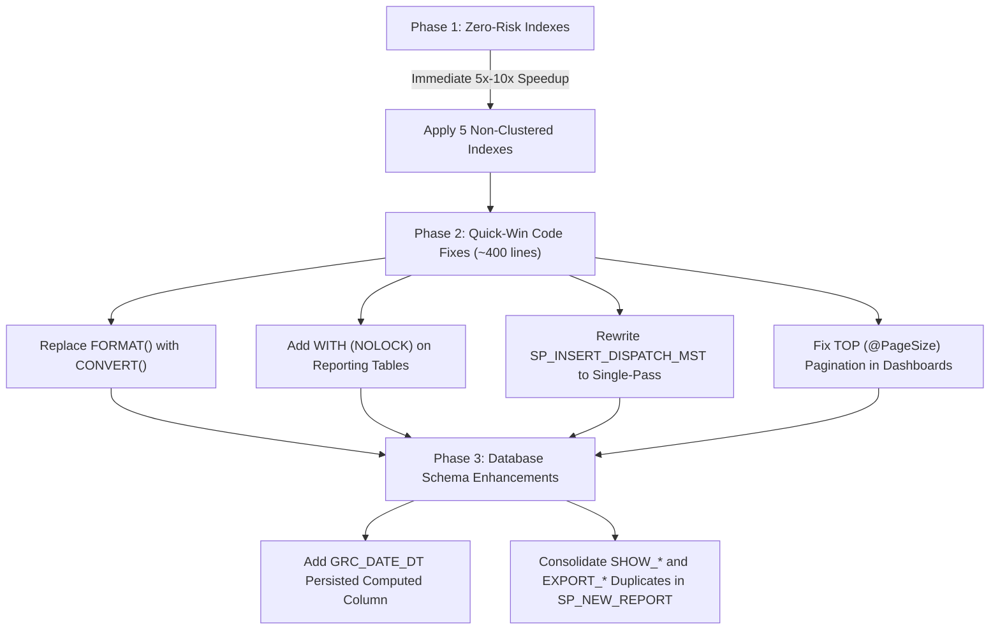

# Vishal Mega Mart — Database Stored Procedure Optimization Guide

> **Note:** The master copy of this document is maintained in [`VMM-querries/DATABASE_QUERY_OPTIMIZATION_GUIDE.md`](file:///c:/Users/MARKSS/OneDrive/Documents/VMM%20Master%20Folder/VMM-querries/DATABASE_QUERY_OPTIMIZATION_GUIDE.md).

## Executive Summary & Production Database Profile

This document details the architectural bottlenecks, locking behaviors, and query execution plans for the **4 production Stored Procedures** powering the **VMM POS & Retail Solution** on the `VMM_RFID_RETAIL_SOLUTION` database:

1. **`SP_New_Dashboard.sql`** — Executive KPIs, store health metrics, and transaction summaries.
2. **`SP_NEW_REPORT.sql`** — Primary tabular reporting, reconciliation grids, and CSV/Excel exports.
3. **`SP_Master.sql`** — Master lookups, user authorization, and dropdown bindings.
4. **`SP_INSERT_DISPATCH_MST.sql`** — High-volume Table-Valued Parameter (TVP) dispatch inwarding.

### Production Table Sizing (Active Environment Audit)

| Physical Table | Row Count | Current Indexes | Major Bottleneck Observed |
| :--- | :---: | :--- | :--- |
| **`tbl_Encoding_Dtl`** | **2,212,406** | PK (Clustered), 3 Non-Clustered | Heavy `FORMAT(Encode_Date)` calls force CPU spikes on 2.2M rows. |
| **`VPOS_SALE_RET_DTL`** | **1,520,070** | PK (Clustered) Only | **No index on `(STORE_CODE, BILL_DATE)`**; triggers full 1.5M row scans. |
| **`VPOS_SCAN_ITEMS_DTL`** | **1,487,658** | PK (Clustered) Only | **No index on `(STORE_CODE, BILL_DATE)`**; triggers full 1.48M row scans. |
| **`tbl_SAP_DC_Outward_Dtl`**| **519,379** | PK (Clustered), 1 Non-Clustered | Joined on unindexed `Ref_No` and non-sargable scan date strings. |
| **`tbl_GRC_DETAILS`** | **334,266** | PK (Clustered), 1 Unique Key | `TRY_CONVERT(DATE, GRC_DATE, 105)` evaluated row-by-row on joins. |
| **`tbl_STORE_GRC_MST_DTL`** | **188,211** | PK (Clustered), 1 Non-Clustered | Hash aggregation spills to `tempdb` when joined with GRC details. |
| **`tbl_Cycle_count_Dtl`** | **72,914** | PK (Clustered) Only | Partition window functions (`ROW_NUMBER()`) scan unindexed dates. |

---

## Missing Index Matrix (Immediate 5x–10x Speedup)

Executing these index creation scripts directly resolves the primary I/O bottlenecks without requiring immediate code changes:

```sql
USE [VMM_RFID_RETAIL_SOLUTION];
GO

-- 1. Accelerates Sale, Void, and Return Dashboards (1.52 Million Rows)
IF NOT EXISTS (SELECT 1 FROM sys.indexes WHERE name = 'IX_VPOS_SALE_RET_DTL_Store_BillDate')
BEGIN
    CREATE NONCLUSTERED INDEX [IX_VPOS_SALE_RET_DTL_Store_BillDate]
    ON [dbo].[VPOS_SALE_RET_DTL] ([STORE_CODE], [BILL_DATE])
    INCLUDE ([SALE_QTY], [RET_QTY], [COUNTER_NO], [ITEM_CD], [BILL_NO])
    WITH (ONLINE = ON, DATA_COMPRESSION = PAGE);
END
GO

-- 2. Accelerates Scan Item Reconciliation & Matching (1.48 Million Rows)
IF NOT EXISTS (SELECT 1 FROM sys.indexes WHERE name = 'IX_VPOS_SCAN_ITEMS_DTL_Store_BillDate')
BEGIN
    CREATE NONCLUSTERED INDEX [IX_VPOS_SCAN_ITEMS_DTL_Store_BillDate]
    ON [dbo].[VPOS_SCAN_ITEMS_DTL] ([STORE_CODE], [BILL_DATE])
    INCLUDE ([SCAN_ITEM_EAN_CD], [ITEM_CD], [COUNTER_NO])
    WITH (ONLINE = ON, DATA_COMPRESSION = PAGE);
END
GO

-- 3. Accelerates Store GRC Validation & Inwarding (334,000 Rows)
IF NOT EXISTS (SELECT 1 FROM sys.indexes WHERE name = 'IX_tbl_GRC_DETAILS_Store_HU_Status')
BEGIN
    CREATE NONCLUSTERED INDEX [IX_tbl_GRC_DETAILS_Store_HU_Status]
    ON [dbo].[tbl_GRC_DETAILS] ([STORE_CODE], [Is_Status])
    INCLUDE ([HU], [GRC_DATE])
    WITH (ONLINE = ON, DATA_COMPRESSION = PAGE);
END
GO

-- 4. Accelerates SAP DC Outward Lookup (519,000 Rows)
IF NOT EXISTS (SELECT 1 FROM sys.indexes WHERE name = 'IX_tbl_SAP_DC_Outward_Dtl_Ref_ScanDate')
BEGIN
    CREATE NONCLUSTERED INDEX [IX_tbl_SAP_DC_Outward_Dtl_Ref_ScanDate]
    ON [dbo].[tbl_SAP_DC_Outward_Dtl] ([Sending_HU_Scan_Dt], [Ref_No])
    INCLUDE ([HU_No])
    WITH (ONLINE = ON, DATA_COMPRESSION = PAGE);
END
GO

-- 5. Accelerates Dispatch Upload Deduplication (tbl_WH_DISPATCH_MST)
IF NOT EXISTS (SELECT 1 FROM sys.indexes WHERE name = 'IX_tbl_WH_DISPATCH_MST_Composite_Dedup')
BEGIN
    CREATE NONCLUSTERED INDEX [IX_tbl_WH_DISPATCH_MST_Composite_Dedup]
    ON [dbo].[tbl_WH_DISPATCH_MST] ([ZONE], [RDC_STATE], [SHED], [SITE], [RDC_CODE], [STORE_DESCRIPTION])
    WITH (ONLINE = ON, DATA_COMPRESSION = PAGE);
END
GO
```

---

## Phased Implementation Roadmap



See [`VMM-querries/DATABASE_QUERY_OPTIMIZATION_GUIDE.md`](file:///c:/Users/MARKSS/OneDrive/Documents/VMM%20Master%20Folder/VMM-querries/DATABASE_QUERY_OPTIMIZATION_GUIDE.md) for full T-SQL implementations, benchmarks, and rollout plans.
